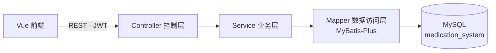

# 💊 老年人智能疗程用药提醒系统

> Elderly Medication Reminder System —— 基于 Spring Boot + Vue 的前后端分离系统，覆盖「疗程计划 → 服药打卡 → 风险预警 → 紧急求助」全流程闭环。

<div align="center">


</div>

本仓库为**后端服务**（REST API，端口 8080），前端基于 Vue 独立开发对接。

## ✨ 功能特性

| 模块 | 说明 |
| --- | --- |
| 👤 患者管理 | 患者基础信息、慢性病史档案 |
| 💊 药品管理 | 名称 / 规格 / 剂量 / 适应症 / 禁忌症 / 不良反应 / 药物相互作用，支持 **Excel 批量导入** |
| 📋 疗程方案 | 患者绑定药品，剂量、频率、起止日期与疗程状态管理 |
| ⏰ 服药记录 | 计划时间 vs 实际时间打卡，TAKEN / MISSED / PARTIAL 状态，支持 **Excel 导出** |
| 🩺 健康档案 | 血压、血糖等体征记录与备注 |
| ⚠️ 风险预警 | 风险类型 / 等级 / 干预建议，待处理预警跟踪 |
| 🆘 紧急求助 | 求助时间、处理人、状态流转闭环 |
| ☎️ 紧急联系人 | 联系人关系、电话、优先级管理 |
| 📊 数据看板 | 患者数、药品数、今日服药计划数、待处理预警数实时统计 |
| 🔐 登录认证 | JWT 认证（24h 有效），ADMIN / PATIENT 双角色，逻辑删除 |

## 🏗️ 架构



- 标准三层架构 `Controller → Service → Mapper`，统一 `Result` 响应封装
- MyBatis-Plus 通用 CRUD、`LambdaQueryWrapper` 条件构造、逻辑删除（`deleted` 字段）
- JWT 无状态认证 + CORS 跨域支持
- Apache POI：药品 Excel 导入 / 服药记录 Excel 导出

## 🗄️ 数据模型（9 张表）

| 表 | 说明 |
| --- | --- |
| `user` | 用户与角色（ADMIN / PATIENT） |
| `patient` | 患者信息（含慢性病史） |
| `medicine` | 药品信息（适应症 / 禁忌 / 相互作用等） |
| `treatment_plan` | 疗程计划（患者 × 药品，剂量 / 频率 / 起止日期） |
| `medication_record` | 服药记录（计划 / 实际时间、状态） |
| `health_record` | 健康档案（血压 / 血糖） |
| `risk_alert` | 风险预警（类型 / 等级 / 干预建议） |
| `emergency_contact` | 紧急联系人（优先级） |
| `emergency_help` | 紧急求助记录（处理人 / 状态） |

## 🚀 快速开始

```bash
git clone https://github.com/zyz18802283164-ux/elder.git
cd elder

# 1. 初始化数据库（含默认账号）
mysql -u root -p < src/main/resources/schema.sql

# 2. 按需修改数据库连接
#    src/main/resources/application.yml → spring.datasource

# 3. 启动（默认端口 8080）
mvn spring-boot:run
```

**默认账号**：`admin / 123456`（系统管理员）、`doctor / 123456`（医护）

## 📁 目录结构

```
src/main/java/com/medication
├── controller/   # 10 个 REST 控制器（业务模块入口）
├── service/      # 业务逻辑层
├── mapper/       # MyBatis-Plus 数据访问层
├── entity/       # 9 个数据库实体
├── dto/          # 请求 / 响应 / 统计对象
├── config/       # CORS 与 MyBatis-Plus 配置
└── util/         # JWT 工具类
```
